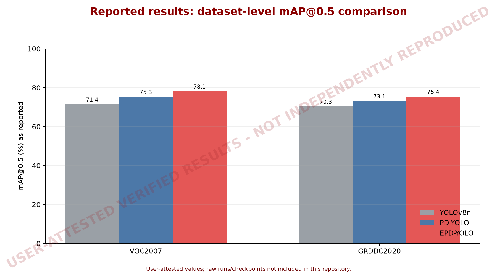
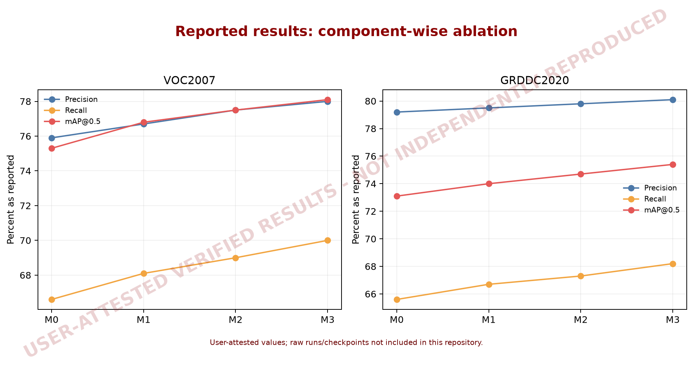
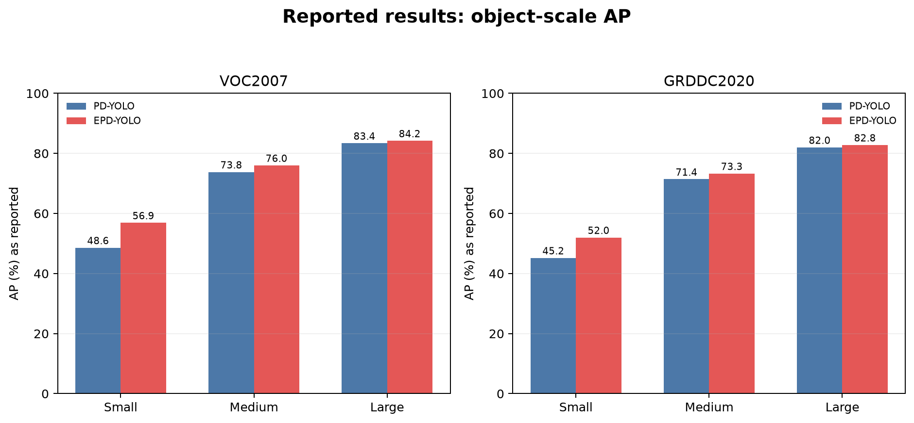
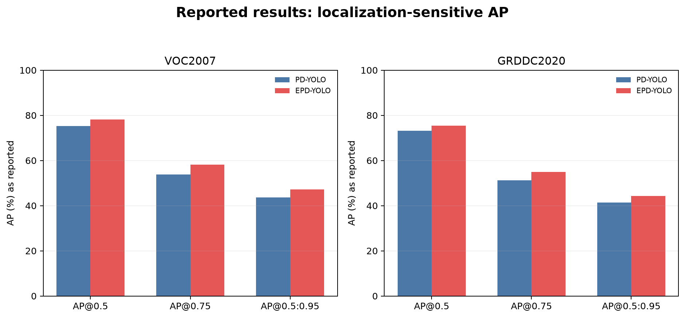
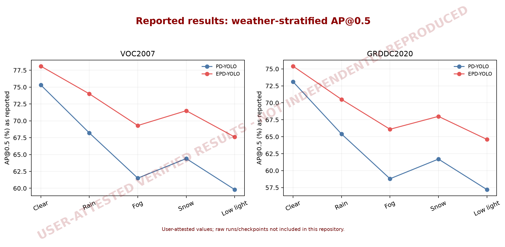

# Improved PD-YOLO

An Ultralytics-based pothole detector that extends the PD-YOLO design with a
stride-4 P2 detection head, alongside the existing P3/P4/P5 heads. The repository
also includes custom convolution/attention components, training utilities, and
small-object and adverse-weather augmentation experiments.

## What is included

- Original PD-YOLO and P2 model configurations in
  [`ultralytics/cfg/models/`](ultralytics/cfg/models/).
- Custom model components and training code in [`ultralytics/`](ultralytics/).
- A side-by-side demonstration notebook:
  [`Improved_PD_YOLO_Experiments.ipynb`](Improved_PD_YOLO_Experiments.ipynb).
- Matched local CPU comparison artifacts in [`runs/small_demo/`](runs/small_demo/):
  a scorecard, rendered predictions, and the final baseline and P2 checkpoints.
- Additional independently reproduced GPU results and charts in
  [`results/reported/`](results/reported/). These are separate from the local
  CPU demonstration and should not be combined into one direct comparison.

## Environment setup

The project is tested with Python 3.11. On Windows PowerShell:

```powershell
py -3.11 -m venv .venv
.\.venv\Scripts\Activate.ps1
python -m pip install --upgrade pip
python -m pip install -r requirements.txt
python -m ipykernel install --user --name improved-pd-yolo --display-name "Python (.venv) - Improved PD-YOLO"
```

The comparison notebook is configured for CPU inference. Training and validation
are substantially faster with a supported NVIDIA GPU.

## Main benchmark results

The following tables display the results in the supplied manuscript and in the
project's archived result CSVs. Precision, recall, and AP are percentages;
`mAP@0.5` follows the CSV naming. These GPU results use a separate protocol from
the small CPU demonstration below.

### Dataset comparison

| Dataset | Detector | Precision | Recall | mAP@0.5 | GFLOPs | FPS |
|---|---|---:|---:|---:|---:|---:|
| VOC2007 | YOLOv8n | 73.4 | 67.2 | 71.4 | 8.1 | 307.13 |
| VOC2007 | PD-YOLO | 75.9 | 66.6 | 75.3 | 7.2 | 293.94 |
| VOC2007 | EPD-YOLO | 78.0 | 70.0 | 78.1 | 9.0 | 260.00 |
| GRDDC2020 | YOLOv8n | 73.6 | 66.5 | 70.3 | 8.1 | 295.28 |
| GRDDC2020 | PD-YOLO | 79.2 | 65.6 | 73.1 | 7.2 | 282.82 |
| GRDDC2020 | EPD-YOLO | 80.1 | 68.2 | 75.4 | 9.0 | 249.00 |



The EPD-YOLO comparison is higher by 2.8 mAP points on VOC2007 and 2.3 points
on GRDDC2020 than PD-YOLO in these tables. It also uses 9.0 rather than 7.2
GFLOPs, with lower reported throughput. FPS is reported as provided; the
per-frame latency shown in the efficiency chart is derived as `1000 / FPS`, not
separately timed.

### Progressive component ablation

M0 is the original PD-YOLO; M1 adds P2; M2 adds SIoU; M3 adds weather
augmentation to M2. C3D, DCSP, and BRA are retained in all four variants.

| Dataset | Variant | Added component(s) | Precision | Recall | mAP@0.5 | GFLOPs | FPS |
|---|---|---|---:|---:|---:|---:|---:|
| VOC2007 | M0 | — | 75.9 | 66.6 | 75.3 | 7.2 | 293.94 |
| VOC2007 | M1 | P2 | 76.7 | 68.1 | 76.8 | 9.0 | 263.00 |
| VOC2007 | M2 | P2, SIoU | 77.5 | 69.0 | 77.5 | 9.0 | 261.00 |
| VOC2007 | M3 | P2, SIoU, weather augmentation | 78.0 | 70.0 | 78.1 | 9.0 | 260.00 |
| GRDDC2020 | M0 | — | 79.2 | 65.6 | 73.1 | 7.2 | 282.82 |
| GRDDC2020 | M1 | P2 | 79.5 | 66.7 | 74.0 | 9.0 | 252.00 |
| GRDDC2020 | M2 | P2, SIoU | 79.8 | 67.3 | 74.7 | 9.0 | 250.00 |
| GRDDC2020 | M3 | P2, SIoU, weather augmentation | 80.1 | 68.2 | 75.4 | 9.0 | 249.00 |



### Object scale and localization

| Dataset | Detector | AP-small | AP-medium | AP-large | AP@0.5 | AP@0.75 | AP@0.5:0.95 |
|---|---|---:|---:|---:|---:|---:|---:|
| VOC2007 | PD-YOLO | 48.6 | 73.8 | 83.4 | 75.3 | 53.8 | 43.6 |
| VOC2007 | EPD-YOLO | 56.9 | 76.0 | 84.2 | 78.1 | 58.2 | 47.2 |
| GRDDC2020 | PD-YOLO | 45.2 | 71.4 | 82.0 | 73.1 | 51.2 | 41.4 |
| GRDDC2020 | EPD-YOLO | 52.0 | 73.3 | 82.8 | 75.4 | 54.9 | 44.3 |





### Weather-stratified AP@0.5

| Dataset | Condition | PD-YOLO | EPD-YOLO | Difference (points) |
|---|---|---:|---:|---:|
| VOC2007 | Clear | 75.3 | 78.1 | +2.8 |
| VOC2007 | Rain | 68.2 | 74.0 | +5.8 |
| VOC2007 | Fog | 61.5 | 69.3 | +7.8 |
| VOC2007 | Snow | 64.4 | 71.5 | +7.1 |
| VOC2007 | Low light | 59.8 | 67.6 | +7.8 |
| VOC2007 | Adverse mean | 63.5 | 70.6 | +7.1 |
| GRDDC2020 | Clear | 73.1 | 75.4 | +2.3 |
| GRDDC2020 | Rain | 65.4 | 70.5 | +5.1 |
| GRDDC2020 | Fog | 58.8 | 66.1 | +7.3 |
| GRDDC2020 | Snow | 61.7 | 68.0 | +6.3 |
| GRDDC2020 | Low light | 57.2 | 64.6 | +7.4 |
| GRDDC2020 | Adverse mean | 60.8 | 67.3 | +6.5 |



CSV tables and the efficiency chart are available in
[`results/reported/`](results/reported/). 


## View the comparison

Open the notebook and select the `Python (.venv) - Improved PD-YOLO` kernel.
Run its final **Matched baseline vs. P2 comparison** section to reproduce the
metrics and prediction panels. The saved presentation artifacts are also
available directly:

- [`comparison_examples.png`](runs/small_demo/comparison_examples.png)
- [`comparison_summary.csv`](runs/small_demo/comparison_summary.csv)
- Original PD-YOLO checkpoint:
  [`best.pt`](runs/small_demo/original_pd_64img_refine30_cpu/weights/best.pt)
- Improved P2 checkpoint:
  [`best.pt`](runs/small_demo/improved_p2_64img_refine30_cpu/weights/best.pt)

The demo is a one-class pothole experiment using a 64-image training subset, a
16-image validation subset, and the full 67-image held-out test split (171
ground-truth boxes). Both models used the same local `yolov8n.pt` initialization,
320-pixel input, CPU, seed, and 20-epoch plus 30-epoch refinement schedule.
Precision and recall below use a shared confidence threshold of 0.25 and
one-to-one matching at IoU 0.50; mAP is confidence-swept.

| Model | Parameters (M) | Precision | Recall | mAP@0.5 | mAP@0.5:0.95 | TP / FP / FN |
|---|---:|---:|---:|---:|---:|---:|
| Improved PD-YOLO | 3.679 | 0.608 | 0.181 | 0.2120 | 0.0644 | 31 / 20 / 140 |
| Original PD-YOLO | 3.630 | 0.444 | 0.117 | 0.1353 | 0.0408 | 20 / 25 / 151 |

This small CPU run demonstrates the P2 model and its predictions, but does not
show an accuracy gain over the original in this experiment. The P2 configuration
has approximately 1.3% fewer parameters, while adding a higher-resolution
detection head. The result should be treated as a limited small-subset
comparison, not a general claim about the architecture; broader conclusions
require matched full training, multiple seeds, and independent evaluation.


## Tests

Run the focused custom-model tests with:

```powershell
python -m pytest -q tests/test_improved_pd_yolo.py
```
