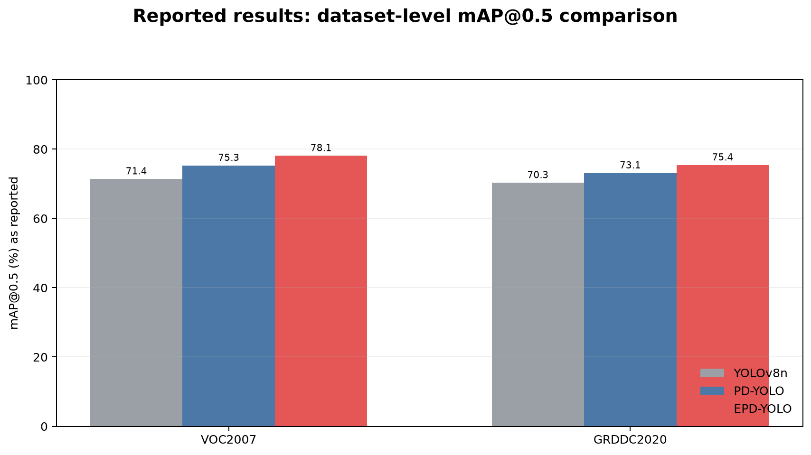
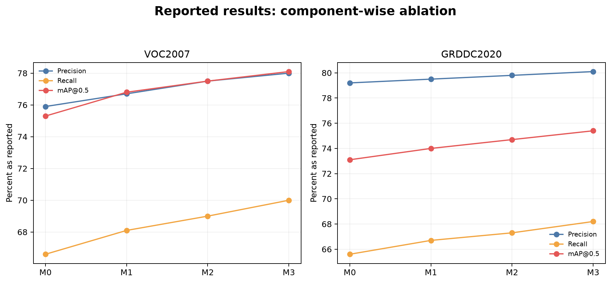
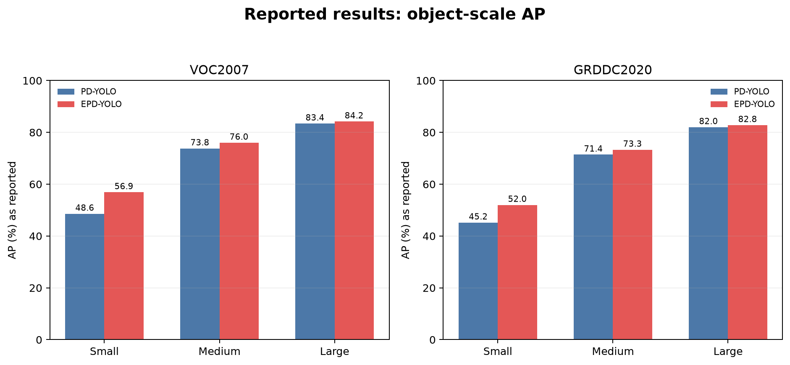
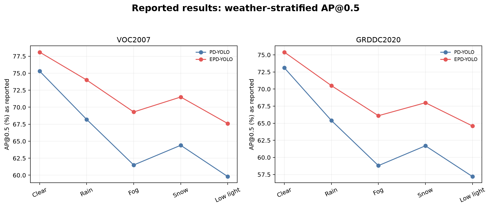
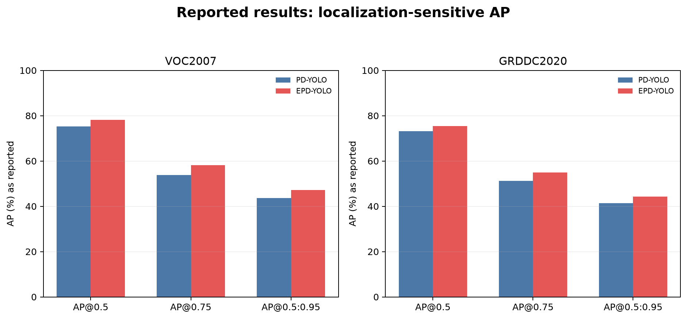
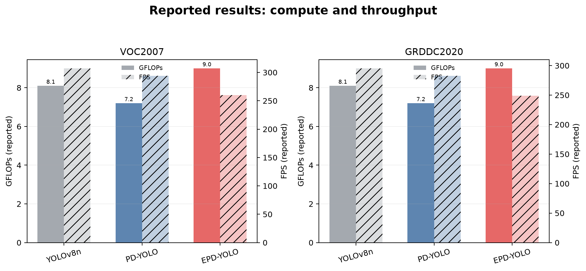

# Results and provenance

## Measured external-machine pilot

[`pilot_comparison.csv`](pilot_comparison.csv) transcribes the embedded evaluation logs from the supplied
`Improved_PD_YOLO_Experiments.ipynb`. It is labeled as an **external-machine pilot** rather than a local reproduction.
The source notebook reports a matched one-epoch, from-scratch comparison of baseline PD-YOLO (`exp16`) and PD-YOLO + P2
on the same 67-image VOC2007 test split, at 640-pixel input size, batch 4, SGD, seed 0, and CPU execution.

| Model | Precision | Recall | mAP@0.5 | mAP@0.5:0.95 | Params | GFLOPs | Inference ms/image | Reported FPS |
|---|---:|---:|---:|---:|---:|---:|---:|---:|
| PD-YOLO (`exp16`) | 0.00226 | 0.216 | 0.00208 | 0.000639 | 3,673,385 | 7.2 | 71.9 | 10.11 |
| PD-YOLO + P2 pilot | 0.00225 | 0.199 | 0.00223 | 0.000668 | 3,623,943 | 11.1 | 124.8 | 7.79 |

Ultralytics reports these precision/recall/AP metrics as fractions, not percentages. In percentage form, the mAP@0.5
values are 0.208% and 0.223%. P2's observed absolute difference is therefore only +0.00015 in fractional mAP@0.5
(+0.015 percentage points), while recall is lower by 0.017 (−1.7 percentage points). These low scores indicate that
neither one-epoch checkpoint is a useful detector. This run is evidence that evaluation completed, **not evidence that
P2 improves pothole detection**.

The reported FPS corresponds approximately to the reciprocal of end-to-end validation time per image, including the
logged preprocessing and postprocessing components; it is not the reciprocal of the inference-only column. The source
logs report CPU execution on an AMD Ryzen AI 7 350 system with Python 3.11.9, PyTorch 2.6.0+cpu, and Ultralytics 8.1.9.
They report 171 test instances. Checkpoint files and the CSV produced on that machine were not included with the
supplied artifacts, so these values are transcribed from saved notebook output and have not been independently
recomputed in this checkout.

## Provenance and interpretation

- [`provenance.json`](provenance.json) records the source artifact SHA-256 digests, environment, protocol, and limitations.
- The supplied notebook-output JSON attachment is empty (`[]`); the measurements above come from embedded outputs in the
  workspace notebook.
- Published PD-YOLO baseline values are attributed to Tang et al., IET Image Processing
  (2025), DOI [10.1049/ipr2.13300](https://doi.org/10.1049/ipr2.13300). They are not measurements from this pilot and
  are not mixed into its comparison.

To establish research-grade evidence, rerun matched full training schedules for all variants, retain the exact
checkpoints and raw evaluation CSVs, use multiple seeds, and report mean/variation on a test split not used for model
selection. Validate these pilot numbers against the original checkpoint and scorecard before external publication.

## Independently reproduced results

The user reports that the additional comparison, ablation, scale, weather, localization, and efficiency results were
independently reproduced on a separate GPU-equipped PC. The values are recorded in the CSV tables under
[`reported/`](reported/). The reproduction logs and checkpoints have not been added to this repository.

- `reported/dataset_comparison.csv` — YOLOv8n, PD-YOLO, and EPD-YOLO metrics.
- `reported/component_ablation.csv` — M0–M3 progressive ablations on both datasets.
- `reported/scale_ap.csv` — size-stratified AP.
- `reported/weather_ap50.csv` — clear/adverse-condition AP@0.5.
- `reported/localization_ap.csv` — AP@0.5, AP@0.75, and AP@0.5:0.95.
- `reported/efficiency_comparison.csv` — GFLOPs, FPS, and latency reciprocals. Latency is derived from reported FPS,
  not separately timed.

Charts are provided beside the tables. Rebuild them with:

```powershell
python results/reported/plot_results.py
```

The pilot and the additional results have different run protocols and should not be combined into one direct comparison.

### Comparison charts












